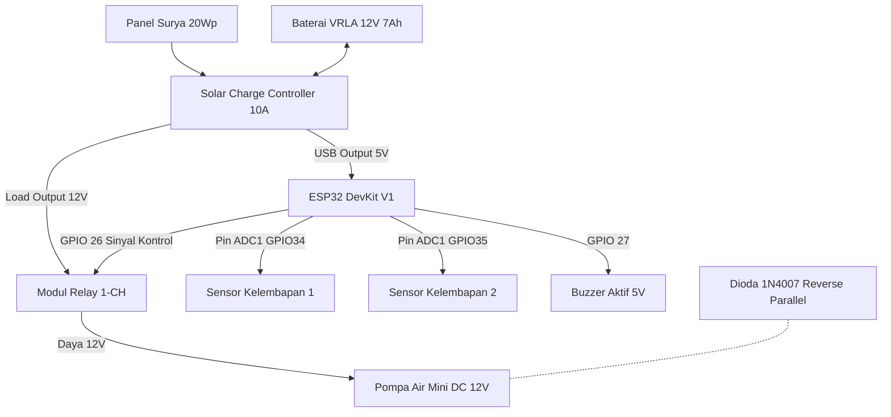
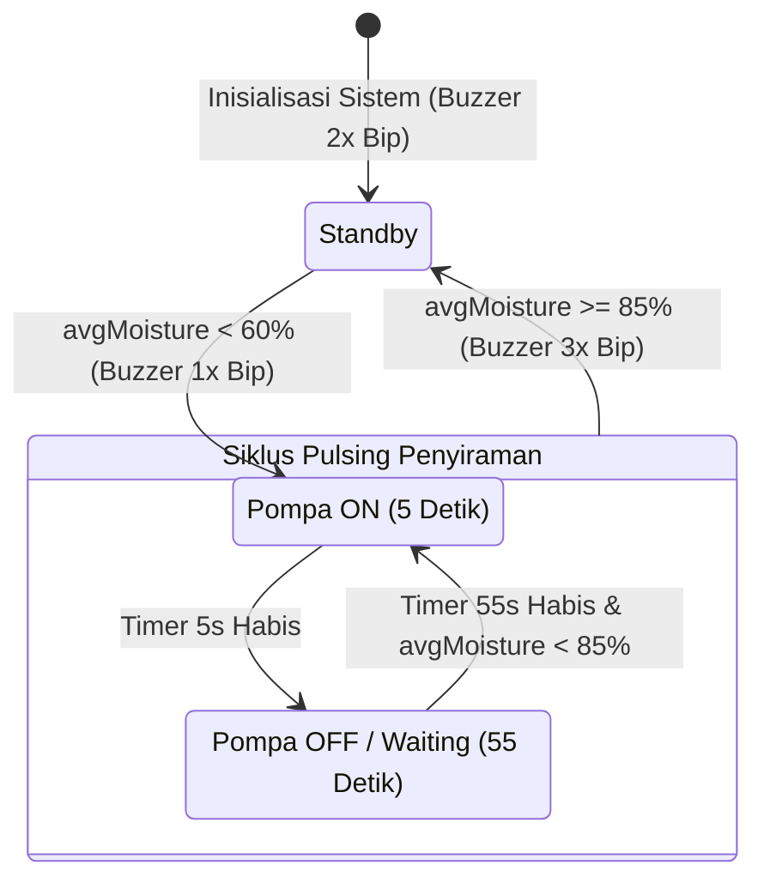

# Product Requirement Document (PRD)
## Prototipe Sistem Penyiraman Otomatis Berbasis Energi Surya & ESP32

---

### 1. Informasi Dokumen
* **Nama Proyek:** Prototipe Sistem Irigasi Otomatis Cerdas Berorientasi Panel Surya
* **Versi Dokumen:** 1.0.0
* **Tanggal:** 8 September 2026
* **Status:** Draft Disetujui (Ready for Implementation)
* **Target Area & Lahan:** Lahan 80x40 cm, 2 Pot Tanaman (20x80 cm)

---

### 2. Ringkasan Eksekutif & Tujuan Proyek

#### 2.1 Ringkasan
Proyek ini bertujuan untuk membangun prototipe sistem penyiraman otomatis terisolasi (*off-grid*) yang memanfaatkan energi baru terbarukan berupa Panel Surya (Solar Panel). Sistem dikendalikan oleh mikrokontroler ESP32 DevKit V1 dan dilengkapi dua buah sensor kelembapan tanah kapasitif untuk mengukur kelembapan secara presisi pada dua lokasi pot terpisah.

#### 2.2 Tujuan Utama
1. **Otomatisasi Penyiraman:** Mengurangi intervensi manual dalam penyiraman tanaman dengan mengukur tingkat kelembapan tanah secara *real-time*.
2. **Efisiensi Energi (Off-Grid Solar):** Mampu beroperasi 24/7 tanpa bergantung pada jaringan listrik PLN, menggunakan solar panel 20Wp dan baterai VRLA 12V 7Ah.
3. **Efisiensi Air & Penyerapan Optimal:** Menggunakan algoritma penyiraman *pulsing* (5 detik nyala, 55 detik jeda peresapan) guna memastikan air terdistribusi merata tanpa penggenangan.
4. **Ketahanan Alat (Longevity):** Memakai sensor kapasitif v1.2 anti-korosi dan komponen proteksi *flyback diode* untuk mencegah lonjakan tegangan balik *back-EMF* dari motor DC.

---

### 3. Arsitektur Sistem & Spesifikasi Perangkat Keras

#### 3.1 Blok Diagram Sistem


#### 3.2 Spesifikasi Komponen Hardware

| Komponen | Spesifikasi / Tipe | Output / Fungsi Utama |
| :--- | :--- | :--- |
| **Mikrokontroler** | ESP32 DevKit V1 (30 Pin) | Pusat pemroses data sensor & logika relay |
| **Sensor Kelembapan** | Capacitive Soil Moisture v1.2 (2 pcs) | Pembacaan analog kelembapan (Pin ADC1) |
| **Panel Surya** | Monocrystalline 20Wp 18V | Pembangkit energi matahari |
| **Penyimpan Daya** | Baterai VRLA / Aki Kering 12V 7Ah | Sumber energi cadangan (kapasitas ~84 Wh) |
| **Manajemen Daya** | SCC PWM 10A dengan Dual USB 5V | Pengatur cas aki & penyedia daya 5V ke ESP32 |
| **Aktuator Air** | Pompa Air Mini DC 12V (R385/365) | Pengalir air dari tandon ke selang drip |
| **Saklar Elektronik** | Modul Relay 1-Channel 5V Optocoupler | Pengendali daya 12V pompa via sinyal GPIO |
| **Proteksi Elektrik** | Dioda 1N4007 | *Flyback diode* pemotong lonjakan tegangan induktif |
| **Indikator Suara** | Buzzer Aktif 5V | Sinyal audio status penyiraman |
| **Penampung Air** | Galon Air 19 Liter + Selang PE 5/16" | Tandon & distribusi air ke 2 pot |

---

### 4. Skema Pinout & Pengkabelan

| Komponen Perangkat | Pin Komponen | Pin ESP32 DevKit | Jenis Sinyal |
| :--- | :--- | :--- | :--- |
| **Sensor Kelembapan 1** | VCC / GND / AOUT | 5V / GND / **GPIO 34** | Analog Input (ADC1) |
| **Sensor Kelembapan 2** | VCC / GND / AOUT | 5V / GND / **GPIO 35** | Analog Input (ADC1) |
| **Modul Relay** | VCC / GND / IN | 5V / GND / **GPIO 26** | Digital Output (Active-LOW) |
| **Buzzer Aktif** | VCC / GND / I/O | 5V / GND / **GPIO 27** | Digital Output |
| **Sumber Daya ESP32** | Micro-USB Port | Port USB 5V SCC | Power Supply 5V DC |
| **Pompa Air DC** | Positif (+) / Negatif (-) | Relay NO (12V) / GND SCC | Daya Motor 12V DC |

*Catatan Tambahan:* Dioda 1N4007 dipasang paralel-terbalik (*reverse parallel*) langsung pada terminal kabel Pompa DC (Katoda ke +, Anoda ke -).

---

### 5. Logika Perangkat Lunak & Algoritma Operasional

#### 5.1 Parameter Variabel
* `lowerThreshold` = 60% *(Sistem aktif jika rata-rata kelembapan < 60%)*
* `upperThreshold` = 85% *(Sistem berhenti jika rata-rata kelembapan >= 85%)*
* `pumpOnTime` = 5000 ms *(Durasi pompa menyala dalam 1 siklus)*
* `soakTime` = 55000 ms *(Durasi jeda tunggu peresapan air ke dalam tanah)*

#### 5.2 Flowchart Operasional
1. **Inisialisasi Sistem:** Setup Serial Monitor (115200 bps), inisialisasi pin GPIO, pembacaan status awal. Buzzer berbunyi 2x bip.
2. **Pembacaan Sensor:** ESP32 membaca tegangan analog dari Sensor 1 (GPIO 34) dan Sensor 2 (GPIO 35), mengonversinya menjadi persentase kelembapan (0–100%), lalu menghitung nilai rata-rata (`avgMoisture`).
3. **Pemeriksaan Kondisi Mulai:**
   * Jika `avgMoisture < lowerThreshold` dan sistem belum dalam siklus siram, aktifkan `isWateringActive = true`.
   * Buzzer berbunyi 1x bip panjang.
4. **Siklus Pulsing Penyiraman (PUMP_ON & PUMP_SOAKING):**
   * **Fase ON:** Nyalakan Relay (Pompa ON) selama `pumpOnTime` (5 detik).
   * **Fase SOAKING:** Matikan Relay (Pompa OFF) selama `soakTime` (55 detik) agar air menyebar merata di dalam pot.
5. **Evaluasi Ulang & Terminasi:**
   * Setelah jeda 55 detik, baca kembali nilai `avgMoisture`.
   * Jika `avgMoisture >= upperThreshold`, hentikan siklus penyiraman (`isWateringActive = false`). Buzzer berbunyi 3x bip pendek.
   * Jika `avgMoisture < upperThreshold`, ulangi Fase ON (5 detik) dan SOAKING (55 detik).

---

### 6. Desain Data & Pemodelan Sistem (ERD & State Machine)

#### 6.1 State Machine Diagram (Status Penyiraman)


#### 6.2 Entity Relationship Diagram (ERD) / Struct Logika Telemetri
Meskipun prototipe ini beroperasi secara independen (*stand-alone*), pemodelan entitas data disiapkan untuk pengembangan modul IoT telemetri di masa depan.

```
+-----------------------------------+        +-----------------------------------+
|            SYSTEM_LOG             |        |          SENSOR_READING           |
+-----------------------------------+        +-----------------------------------+
| PK  log_id        : INT (Auto)    |        | PK  reading_id   : INT (Auto)     |
| FK  device_id     : STRING        | 1    N | FK  log_id       : INT            |
|     timestamp     : DATETIME      |<───────|     sensor_num   : INT (1 / 2)    |
|     avg_moisture  : INT (%)       |        |     raw_adc      : INT (0-4095)   |
|     system_state  : ENUM          |        |     percentage   : INT (%)        |
|     pump_status   : BOOLEAN       |        +-----------------------------------+
+-----------------------------------+
```

---

### 7. Persyaratan Non-Fungsional (NFR)

1. **Andal & Tahan Cuaca (Reliability & Weatherproofing):**
   * Seluruh komponen elektronik utama (ESP32, Relay, SCC, Baterai) terpasang di dalam *Box Enclosure IP65* tahan cipratan air dan debu outdoor.
2. **Otonomi Daya (Power Autonomy):**
   * Sistem mampu beroperasi tanpa sinar matahari (*Autonomy Days*) selama minimal 3-4 hari berturut-turut berkat baterai 7Ah (konsumsi daya total ~14 Wh/hari).
3. **Keamanan Hardware (Hardware Safety):**
   * Penggunaan *Flyback Diode* 1N4007 wajib untuk mencegah *crash/reset* pada ESP32 yang disebabkan fluktuasi arus induktif dari motor pompa DC.
   * Proteksi *Low Voltage Disconnect* (LVD) otomatis dipandu oleh SCC untuk mencegah baterai VRLA mengalami *over-discharge* (< 10.8V).

---

### 8. Rencana Pengujian (Test Plan) & Kriteria Penerimaan

| ID Uji | Item Pengujian | Prosedur Uji | Hasil yang Diharapkan | Status |
| :--- | :--- | :--- | :--- | :--- |
| **TP-01** | Sumber Daya USB SCC | Sambungkan USB SCC ke Port USB ESP32 | ESP32 menyala stabil pada tegangan 5.0V ± 0.2V | Pass |
| **TP-02** | Pembacaan Sensor Kering | Letakkan kedua sensor di udara terbuka | Nilai ADC ~3200 (Kelembapan terhitung 0 - 10%) | Pass |
| **TP-03** | Pembacaan Sensor Basah | Celupkan sensor ke dalam gelas berisi air | Nilai ADC ~1500 (Kelembapan terhitung 90 - 100%) | Pass |
| **TP-04** | Siklus Pulsing Pompa | Picu kondisi kelembapan < 60% | Pompa menyala 5 detik, mati 55 detik, berulang | Pass |
| **TP-05** | Terminasi Penyiraman | Buat kelembapan tanah mencapai > 85% | Pompa berhenti otomatis, buzzer berbunyi 3x | Pass |
| **TP-06** | Dioda Proteksi Back-EMF | On-Off pompa berulang kali 10x cepat | ESP32 tidak mengalami *random reset* atau hang | Pass |

---

### 9. Pengembangan Masa Depan (Roadmap)
* **Fase 2:** Penambahan fitur WiFi Dashboard menggunakan Protocol MQTT / Blynk IoT untuk pemantauan grafis kelembapan tanah secara remote dari Smartphone.
* **Fase 3:** Implementasi mode *Deep Sleep* pada ESP32 untuk menekan konsumsi daya hingga < 1 mA saat kondisi tanah masih basah.
* **Fase 4:** Integrasi sensor ketinggian air (*water level sensor*) pada tandon galon 19L untuk memberi peringatan jika stok air habis.
