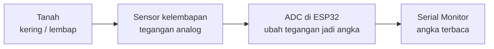

# Bahan Ajar Pertemuan 2: ESP32, Pin, Sensor, dan Pembacaan Data

**Alokasi waktu:** 2 JP = 90 menit (asumsi 1 JP = 45 menit)  
**Sasaran:** SMA pemula; dapat disesuaikan untuk jenjang lain  
**Konteks proyek:** sistem penyiraman otomatis berbasis ESP32

## Gambaran pembelajaran

Siswa mengenali ESP32 DevKit V1 dan fungsi pin, membedakan masukan dan keluaran, memahami fungsi sensor kelembapan kapasitif serta relay/driver, menggambar dan menghubungkan sensor sesuai spesifikasi modul, lalu membaca dan mencatat nilai sensor melalui ADC dan Serial Monitor. Pertemuan ini berfokus pada komponen, pin, keselamatan, dan pembacaan data mentah; pompa tidak dioperasikan dan nilai belum dikalibrasi menjadi persen.

### Mengapa proyek ini menggunakan ESP32?

ESP32 dipilih karena sesuai dengan rancangan proyek: board ini memiliki GPIO dan kemampuan pemrosesan yang memadai untuk membaca sensor serta mengendalikan sistem, dan umumnya menyediakan Wi-Fi/Bluetooth bawaan untuk pengembangan IoT di kemudian hari. GPIO ESP32 menggunakan logika 3,3 V, sehingga tegangan sensor dan modul yang dipasang harus diperiksa agar sesuai.

Arduino Nano, Uno, atau Mega juga dapat digunakan untuk banyak proyek kendali sederhana. Namun, varian klasik umumnya tidak memiliki Wi-Fi/Bluetooth bawaan, dan sebagian besar menggunakan logika 5 V sehingga antarmuka dengan sensor atau modul 3,3 V perlu diperiksa atau disesuaikan. Setiap board juga memiliki pinout, kemampuan, dan kebutuhan wiring yang berbeda. Jadi, ESP32 bukan selalu pilihan terbaik untuk semua proyek; untuk pembelajaran ini kita menggunakannya karena menjadi board yang ditetapkan pada rancangan sistem penyiraman.

### Tujuan pembelajaran

Pada akhir pembelajaran, siswa mampu:

1. Menjelaskan mikrokontroler sebagai pengendali yang membaca masukan, menjalankan program, lalu mengatur keluaran.
2. Mengelompokkan contoh komponen sebagai masukan, pemroses, atau keluaran.
3. Menunjukkan pin daya, GND, GPIO, dan pin analog pada ESP32 DevKit V1 dengan bantuan diagram pin board yang digunakan.
4. Menjelaskan fungsi sensor kelembapan kapasitif dan relay/driver dalam sistem penyiraman.
5. Menggambar dan, setelah diperiksa guru, menghubungkan sensor ke ESP32 dengan polaritas dan tegangan yang sesuai spesifikasi.
6. Menjelaskan bahwa ADC mengubah tegangan sensor menjadi angka digital.
7. Membaca nilai sensor melalui Serial Monitor dengan baud rate yang benar.
8. Mencatat nilai sensor pada beberapa sampel tanah dengan posisi sensor yang konsisten.
9. Menyebutkan sekurang-kurangnya tiga aturan keselamatan, baik sebelum maupun saat rangkaian diberi daya.

### Kriteria keberhasilan

- Label pin pada gambar tidak tertukar: VCC/catu, GND, dan OUT/sinyal.
- Siswa menyebutkan bahwa GPIO ESP32 menggunakan logika 3,3 V dan tidak boleh menerima sinyal 5 V.
- Siswa menjelaskan bahwa pompa tidak disambungkan langsung ke GPIO; diperlukan driver/relay dan jalur daya yang sesuai.
- Diagram sambungan diperiksa guru sebelum rangkaian dirakit atau diberi daya.
- Siswa menampilkan nilai sensor di Serial Monitor dengan baud rate yang benar.
- Siswa mencatat nilai pada tanah kering, lembap, dan basah tanpa menyebut angka tersebut sebagai persen secara keliru.
- Siswa tidak menyentuh rangkaian saat diberi daya dan tidak menyiram komponen elektronik.

### Prasyarat dan kosakata

Pengetahuan sebelumnya: siswa telah mengenali tujuan umum proyek dan aturan dasar bekerja dengan perangkat elektronik. Istilah penting: **mikrokontroler**, **masukan/input**, **keluaran/output**, **GPIO**, **GND**, **tegangan**, **sensor**, **relay**, **driver**, **beban**, **ADC**, **tegangan analog**, **nilai digital**, **Serial Monitor**, **baud rate**, **pin masukan analog**, **sampel**, dan **kalibrasi**.

### Alat dan bahan

- ESP32 DevKit V1 atau gambar/foto board beserta pinout yang sesuai dengan board nyata.
- Sensor kelembapan tanah kapasitif dan lembar spesifikasi/manual modul.
- Modul relay atau driver motor sebagai bahan observasi (tidak wajib diberi daya).
- Kabel jumper, lembar kerja, alat tulis; multimeter hanya digunakan dengan arahan guru.
- Komputer dengan Arduino IDE dan sketch pembacaan sensor yang sudah disiapkan serta diuji guru.
- Sampel tanah dalam wadah berlabel: kering, lembap, dan basah.
- Contoh beban seperti pompa boleh ditunjukkan, tetapi tidak perlu dijalankan dalam sesi ini.

**Persiapan guru:** periksa kondisi komponen, identifikasi revisi board dan pinout yang tepat, baca spesifikasi tegangan sensor serta relay/driver, dan siapkan contoh wiring yang aman. Siapkan dan uji sketch pembacaan sensor, tentukan pin analog sesuai pinout board yang benar-benar dipakai, pastikan baud rate program sama dengan Serial Monitor, dan siapkan sampel tanah dengan kondisi yang jelas berbeda. Verifikasi bahwa tegangan sinyal sensor ke pin ADC tidak melebihi 3,3 V. Batas kegiatan: siswa membaca dan mencatat data mentah, tetapi belum menulis program sendiri atau menghitung persen kelembapan.

## Materi inti

### 1. Apa itu mikrokontroler?

Mikrokontroler adalah komputer kecil di dalam sebuah chip yang dapat menjalankan program untuk mengendalikan perangkat. ESP32 pada board DevKit memiliki mikrokontroler, pin masukan/keluaran, dan antarmuka untuk catu daya serta komunikasi.

Dalam sistem penyiraman:


Sensor memberi **informasi** tentang kondisi tanah. ESP32 memproses informasi itu. Relay/driver membantu sinyal kendali ESP32 mengoperasikan beban yang memerlukan jalur daya tersendiri. Jalur sinyal dan jalur daya memiliki fungsi berbeda.

### 2. Input, proses, output, dan GPIO

- **Input/masukan:** data yang diterima sistem, misalnya sinyal dari sensor.
- **Proses:** keputusan yang dibuat program di ESP32.
- **Output/keluaran:** sinyal kendali atau tindakan, misalnya mengaktifkan relay/driver.
- **GPIO (General-Purpose Input/Output):** pin yang dapat digunakan sebagai masukan atau keluaran sesuai kemampuan pin dan pengaturan program.
- **GND (ground):** acuan tegangan/rangkaian. Sambungan GND harus mengikuti diagram dan kebutuhan modul.
- **VCC/3V3/5V:** sambungan catu daya. Label pada board/modul perlu dibaca; pin 5V bukan pin sinyal GPIO.

Sebagian pin ESP32 memiliki fungsi khusus atau batasan. Pilih pin berdasarkan diagram pinout board yang digunakan dan kebutuhan sambungan; jangan memilih nomor pin hanya karena melihat contoh untuk board lain. Pinout dapat berbeda menurut model/revisi board; selalu cocokkan diagram dengan perangkat yang benar-benar digunakan.

### 3. Tegangan logika ESP32

GPIO ESP32 bekerja pada logika **3,3 V** dan tidak tahan menerima sinyal 5 V secara langsung. Tegangan 5 V pada pin GPIO dapat merusak board. Tegangan catu sensor dan batas tegangan sinyal keluarannya harus diperiksa agar sambungan ke ESP32 aman.

Sebelum menghubungkan sensor:

1. Cari spesifikasi tegangan catu sensor.
2. Cari batas tegangan sinyal keluaran sensor.
3. Pastikan sambungan yang direncanakan sesuai dengan batas pin ESP32, yaitu sinyal tidak lebih dari 3,3 V.
4. Jika belum diketahui, **jangan sambungkan atau beri daya**; minta guru memeriksa manual atau gunakan level shifter/pembagi tegangan yang dirancang dan diverifikasi guru.

Gunakan catu 3,3 V hanya jika sensor memang bekerja dengan baik pada tegangan tersebut sesuai spesifikasinya. Jangan menganggap semua pin bertanda VCC selalu harus dihubungkan ke 5 V.

### 4. Sensor kelembapan kapasitif

Sensor kapasitif mendeteksi perubahan sifat listrik di sekitar bagian sensor ketika kadar air tanah berubah. Modul sensor menyediakan sambungan catu, ground, dan keluaran sinyal.

Label yang mungkin ditemukan:

- **VCC:** catu positif sesuai spesifikasi modul.
- **GND:** ground.
- **OUT/AOUT/AO:** keluaran sinyal sensor. Ikuti label modul dan hubungkan ke pin masukan yang ditentukan pada diagram guru.

Ikuti label dan datasheet modul yang tersedia. Jangan merendam sensor atau bagian elektroniknya kecuali manual produsen secara jelas menyatakan aman. Lepaskan daya sebelum memasang atau mengubah kabel.

### 5. Relay, driver, dan beban

Relay adalah saklar yang dioperasikan oleh sinyal listrik. Modul relay dapat memisahkan sisi kendali dari sisi kontak beban, tetapi tingkat isolasi dan cara kerja bergantung pada desain modul. Driver transistor/MOSFET merupakan pilihan lain untuk mengendalikan beban DC. Pompa adalah beban motor yang dapat memerlukan arus lebih besar daripada kemampuan pin mikrokontroler.

- GPIO hanya memberikan sinyal kendali berdaya kecil; **jangan sambungkan pompa langsung ke GPIO**.
- Catu pompa harus sesuai spesifikasi pompa dan melalui rangkaian driver/relay yang rating-nya mencukupi.
- Modul relay dapat aktif-HIGH atau aktif-LOW. Periksa label, datasheet, dan uji sesuai arahan guru; jangan menebak dari bentuk modul.
- Sisi masukan modul relay (misalnya IN, VCC, GND) dan terminal kontak beban (misalnya COM, NO, NC) memiliki fungsi berbeda.
- Wiring pompa, baterai, atau tegangan jaringan bukan bagian praktik mandiri siswa pada sesi ini. Guru memeriksa dan mengawasi pekerjaan tersebut.

### 6. Membaca data: dari tegangan ke angka (ADC)

Sensor menghasilkan **tegangan analog** yang berubah mengikuti kondisi tanah. ESP32 tidak membaca tegangan itu secara langsung; ia memakai **ADC (Analog-to-Digital Converter)** untuk mengubah tegangan menjadi **angka digital** yang dapat diproses program dan ditampilkan.



Angka yang tampil adalah **nilai mentah** hasil konversi ADC. Angka itu bukan langsung "persen kelembapan", melainkan bahan mentah yang nanti diolah lewat kalibrasi (Pertemuan 5).

### 7. Serial Monitor

Serial Monitor adalah alat pada Arduino IDE untuk melihat data yang dikirim ESP32 ke komputer melalui USB. Untuk membaca data dengan benar:

- **Baud rate** pada program (misalnya `Serial.begin(115200)`) harus **sama** dengan baud rate yang dipilih di Serial Monitor. Jika berbeda, angka yang tampil kacau atau tidak terbaca.
- Serial Monitor menampilkan teks yang dikirim program, misalnya `Nilai sensor: 2048`.
- Angka yang sama dapat muncul berbeda sedikit pada pembacaan berikutnya; hal itu wajar dan menjadi bagian yang diamati.

Pada pertemuan ini siswa membaca angka yang dikirim sketch yang disiapkan guru; penulisan program dasar C++ dilakukan pada Pertemuan 4.

### 8. Pin analog dan pin masukan

Untuk membaca tegangan sensor, sensor dihubungkan ke **pin yang mendukung pembacaan analog** pada ESP32:

- Pada ESP32 klasik, **GPIO 34 dan GPIO 35 adalah pin masukan saja** (input-only): keduanya dapat membaca analog tetapi tidak dapat dipakai sebagai keluaran digital.
- Pin lain seperti GPIO 32 dan 33 juga dapat membaca analog pada sebagian besar board; kemampuan pin harus dicocokkan dengan pinout board yang digunakan.
- **Verifikasi pinout** board yang benar-benar dipakai. Jangan menyalin nomor pin dari contoh untuk board/revisi lain.
- Sinyal sensor yang masuk ke pin analog harus berada dalam batas tegangan yang diizinkan (pada ESP32, tidak melebihi 3,3 V).

### 9. Angka ADC bukan persen kelembapan

Nilai yang tampil di Serial Monitor adalah hasil ADC, **bukan** persentase kelembapan. Untuk mengubah nilai itu menjadi persen, diperlukan **kalibrasi** yang menetapkan nilai acuan kering dan lembap; hal itu dibahas pada Pertemuan 5.

Pada pertemuan ini cukup diamati pola dasarnya: sampel kering dan lembap menghasilkan **angka yang berbeda**. Arah perubahannya (naik atau turun saat makin basah) dapat berbeda antarsensor, sehingga kesimpulan harus didasarkan pada hasil pengamatan, bukan angka universal.

### 10. Faktor yang memengaruhi pembacaan

Nilai sensor dapat berubah bukan hanya karena kadar air, tetapi juga karena:

- jenis dan kondisi sensor;
- jenis tanah;
- kedalaman sensor tertanam;
- posisi sensor;
- kestabilan suplai daya.

Oleh karena itu, saat membandingkan beberapa sampel, **kedalaman dan posisi sensor harus dijaga tetap konsisten**. Bandingkan beberapa pembacaan pada setiap sampel dan catat hasilnya, bukan hanya satu angka.

### 11. Keselamatan (tanpa daya dan saat berdaya)

Sebelum rangkaian diberi daya:

- Lepaskan sumber daya saat memasang atau mengubah kabel.
- Periksa polaritas dan pilihan pin sesuai diagram; minta guru memeriksa sebelum memberi daya.

Saat rangkaian diberi daya untuk membaca data:

- **Jangan menyentuh rangkaian, kabel, atau sambungan saat diberi daya.**
- Jangan menyiram atau menaruh air di dekat ESP32, sambungan, dan catu daya.
- Saat memindahkan sensor antar sampel, ikuti arahan guru; lepaskan daya terlebih dahulu bila diminta.

## Alur pembelajaran (90 menit)

| Waktu | Tahap | Aktivitas guru | Aktivitas siswa / bukti |
|---:|---|---|---|
| 0–8 mnt | Pembuka dan apersepsi | Ingatkan tujuan proyek. Tanyakan: “Bagaimana alat mengetahui tanah kering?” dan “Apakah pompa bisa dinyalakan langsung dari pin ESP32?” Sampaikan tujuan dan aturan keselamatan. | Menjawab berdasarkan pengetahuan awal; menuliskan satu hal yang ingin diketahui. |
| 8–20 mnt | Urutan kerja sistem | Jelaskan alur sensor → ESP32 → relay/driver → pompa. Bedakan jalur informasi dan jalur energi. | Menyusun kartu/label input, proses, output pada diagram blok. |
| 20–34 mnt | Mengenali ESP32, pin, dan tegangan | Tunjukkan board tanpa daya dan pinout yang sesuai. Jelaskan GND, pin catu, GPIO, batas logika 3,3 V, dan pin analog (GPIO 34/35 masukan saja). | Berpasangan mencari label yang diminta pada board/diagram; menandai pin pada lembar kerja. |
| 34–46 mnt | Sensor, relay/driver, dan wiring | Tunjukkan sensor dan modul relay/driver. Baca label bersama. Minta siswa menggambar dan menyambungkan sensor saat sumber daya terlepas. | Menggambar dan menghubungkan catu, GND, dan sinyal sesuai diagram; meminta pemeriksaan guru. |
| 46–58 mnt | ADC dan Serial Monitor | Jelaskan ADC (tegangan → angka) dan Serial Monitor, serta baud rate. Demonstrasikan membuka Serial Monitor. | Menyebutkan baud rate yang dipakai dan menandai alur data pada lembar kerja. |
| 58–73 mnt | Membaca dan mencatat data | Bagikan sketch pembacaan sensor yang disiapkan guru. Pandu siswa mengunggah dan membaca nilai. Minta mencatat sampel kering, lembap, dan basah dengan posisi/kedalaman konsisten. | Mengunggah sketch, membaca nilai, dan mengisi tabel pengamatan. |
| 73–82 mnt | Diskusi pola data dan pemeriksaan | Bandingkan nilai antar sampel; bahas mengapa berbeda dan mengapa angka belum menjadi persen. Minta siswa memeriksa tabel teman. | Menuliskan kesimpulan pola; memeriksa tabel pengamatan pasangan. |
| 82–90 mnt | Penutup / exit ticket | Berikan tiga pertanyaan singkat. Rangkum pesan keselamatan dan tegaskan bahwa dasar C++ (Pertemuan 4) serta kalibrasi/persen (Pertemuan 5) menyusul. | Menjawab exit ticket secara mandiri dan mengumpulkan lembar kerja. |

## Lembar kerja siswa

**Nama:** ____________________  **Kelompok:** __________  **Tanggal:** __________

### A. Kelompokkan bagian sistem

Tuliskan **input**, **proses**, atau **output/beban** untuk setiap bagian.

| Bagian | Kelompok | Alasan singkat |
|---|---|---|
| Sensor kelembapan | | |
| ESP32 | | |
| Relay/driver | | |
| Pompa | | |

### B. Kenali pin dan fungsi

Dengan mengacu pada pinout board yang digunakan, temukan dan isi:

| Label/fungsi | Nama pin pada board/komponen | Catatan |
|---|---|---|
| Ground | | |
| Catu yang digunakan sesuai diagram guru | | |
| Pin masukan sensor pada diagram guru | | |
| Pin analog yang dipakai membaca sensor | | |
| Apakah pin analog itu pin masukan saja? (ya/tidak) | | |

Catatan: jangan memakai nomor GPIO hanya karena ada pada contoh internet. Cocokkan dengan board dan kebutuhan proyek.

### C. Gambar dan sambungkan sensor

Gunakan informasi modul yang diberikan guru. **Lepaskan sumber daya saat memasang atau mengubah kabel. Jangan memberi daya sebelum sambungan diperiksa guru.**

```text
Sensor kelembapan                  ESP32 DevKit
VCC / catu      ─────────────────  sesuai diagram guru
GND             ─────────────────  sesuai diagram guru
OUT / sinyal    ─────────────────  pin masukan pada diagram guru
```

Tegangan catu sensor menurut spesifikasi: __________  
Pin catu dan GND yang digunakan: __________  
Pin masukan yang ditunjuk pada diagram: __________  
Pemeriksaan apa yang harus dilakukan sebelum daya disambungkan? __________________

### D. Tabel pengamatan sensor

Gunakan sketch yang disiapkan guru. Jaga **kedalaman dan posisi sensor tetap sama** untuk setiap sampel. Catat tiga pembacaan tiap sampel, lalu isi nilai rata-ratanya (jumlah ketiga nilai dibagi 3).

| Sampel tanah | Kedalaman/posisi | Nilai 1 | Nilai 2 | Nilai 3 | Rata-rata (jumlah ÷ 3) | Catatan |
|---|---|---|---|---|---|---|
| Kering | | | | | | |
| Lembap | | | | | | |
| Basah | | | | | | |
| Tanah di pot/area uji (opsional) | | | | | | |

1. Sampel mana yang memberi nilai paling berbeda? ______________
2. Apakah nilai naik atau turun saat tanah makin basah? ______________
3. Apakah angka-angka itu sudah merupakan persen kelembapan? Mengapa? ______________

### E. Jelaskan dengan kata-katamu

1. Apa yang dilakukan ESP32 ketika kondisi tanah berubah?
2. Mengapa pompa tidak boleh dihubungkan langsung ke GPIO?
3. Apa perbedaan jalur sinyal sensor dan jalur daya pompa?
4. Apa yang dilakukan ADC?
5. Mengapa angka yang tampil di Serial Monitor belum tentu persen kelembapan?
6. Sebutkan dua tindakan aman sebelum mengubah sambungan, dan satu tindakan aman saat rangkaian diberi daya.

## Contoh diagram konseptual dan sketch

Contoh ini menunjukkan **jenis sambungan dan alur data**, bukan jaminan pinout atau tegangan yang cocok untuk semua modul. Guru harus memastikan spesifikasi sensor dan board sebelum praktik. Gunakan nomor pin yang telah dipilih guru berdasarkan board yang tersedia.

```text
Sensor kapasitif                         ESP32 DevKit V1
VCC  ── catu yang sesuai spesifikasi ──  pin catu pada diagram guru
GND  ──────────────────────────────────  GND pada diagram guru
OUT  ── sinyal, sesuai spesifikasi ────  pin masukan analog pada diagram guru

ESP32 GPIO ── sinyal kendali ──> input modul relay/driver
                                  (kompatibilitas logika diperiksa guru)

Catu beban yang sesuai ──> kontak/keluaran driver ──> pompa
```

Berikut contoh sketch yang **disiapkan guru** (siswa mengunggah, tidak menulis sendiri pada pertemuan ini). Nomor pin dan baud rate menyesuaikan diagram guru dan board yang dipakai.

```cpp
// Sketch pembacaan sensor kelembapan (disiapkan guru).
// Siswa mengunggah lalu membaca nilainya di Serial Monitor.

const int sensorPin = 34;   // pin analog sesuai diagram guru (verifikasi board)

void setup() {
  Serial.begin(115200);     // baud rate harus sama dengan Serial Monitor
}

void loop() {
  int nilaiSensor = analogRead(sensorPin); // ADC: tegangan -> angka
  Serial.print("Nilai sensor: ");
  Serial.println(nilaiSensor);
  delay(500);               // jeda 0,5 detik agar angka mudah dibaca
}
```

Pastikan catu sensor sesuai spesifikasi dan tegangan sinyal yang menuju ESP32 tidak melebihi 3,3 V. Jika hal tersebut belum dapat dipastikan, jangan memberi daya; minta guru memeriksa modul dan menentukan sambungan yang aman. Angka yang tampil adalah nilai mentah; mengubahnya menjadi persen dilakukan melalui kalibrasi pada pertemuan berikutnya.

## Asesmen

### Asesmen formatif

Guru mengamati saat siswa:

- menunjuk GND, catu, GPIO, dan pin analog pada board;
- menjelaskan arah informasi sensor hingga keputusan ESP32;
- memilih sambungan berdasarkan label/spesifikasi, bukan warna kabel;
- membuka Serial Monitor dan memilih baud rate yang benar;
- menjaga kedalaman/posisi sensor konsisten saat membandingkan sampel;
- meminta pemeriksaan sebelum menyambungkan daya dan tidak menyentuh rangkaian berdaya.

### Exit ticket

1. GPIO ESP32 menggunakan logika berapa volt? Apakah aman menerima 5 V langsung?
2. Sebutkan fungsi sensor dan fungsi relay/driver dalam sistem penyiraman.
3. Apa yang dilakukan ADC? Apakah angka yang tampil otomatis merupakan persen kelembapan?
4. Mengapa baud rate pada program dan Serial Monitor harus sama?

### Rubrik bukti belajar (10 poin)

| Aspek | 2 poin | 1 poin | 0 poin |
|---|---|---|---|
| Identifikasi pin | Dapat menunjukkan daya, GND, GPIO, dan pin analog dengan benar sesuai pinout | Ada satu kekeliruan yang dapat diperbaiki dengan arahan | Belum dapat mengidentifikasi |
| Fungsi komponen | Menjelaskan fungsi sensor, ESP32, relay/driver, dan pompa secara tepat | Menjelaskan sebagian fungsi | Penjelasan belum tepat |
| Diagram dan sambungan | Semua sambungan dan label benar serta sesuai spesifikasi | Ada kekeliruan kecil yang diperbaiki setelah ditinjau | Diagram belum aman/tidak lengkap |
| Membaca dan mencatat data | Menampilkan nilai di Serial Monitor dengan baud rate benar dan tabel terisi lengkap | Data tampil/tabel terisi setelah dibantu | Belum dapat menampilkan atau mencatat data |
| Keselamatan | Menyebutkan ≥3 aturan, menunggu pemeriksaan guru, dan tidak menyentuh rangkaian berdaya | Menyebutkan 1–2 aturan atau perlu diingatkan | Mengabaikan aturan keselamatan |

**Tuntas:** minimal 7/10 dan tidak ada kesalahan keselamatan kritis (misalnya menghubungkan keluaran 5 V langsung ke GPIO, atau menyentuh sambungan saat berdaya). Guru dapat meminta siswa memperbaiki diagram atau mengulang pengamatan sebelum dinilai tuntas.

## Kunci jawaban / panduan guru

- Bagian A: sensor = input; ESP32 = pemroses; relay/driver = antarmuka kendali/output; pompa = beban/output fisik.
- Bagian B: jawaban pin harus mengikuti board dan diagram yang benar-benar tersedia.
- Bagian C: sambungan catu dan GND mengikuti spesifikasi serta diagram guru; OUT menuju pin masukan yang ditentukan. Pastikan catu sensor sesuai dan sinyal ke ESP32 tidak melebihi 3,3 V. Jika belum diketahui, jangan memberi daya dan minta guru memeriksa manual atau menentukan penyesuai level.
- Bagian D: jawaban nilai bergantung pada hasil pengamatan nyata. Nilai paling berbeda biasanya tanah kering terhadap tanah basah; arah perubahan (naik/turun) bergantung sensor. Angka belum merupakan persen karena belum dikalibrasi.
- Pertanyaan 1: sensor menghasilkan sinyal terkait kondisi tanah; ESP32 menerima informasi dan menjalankan keputusan sesuai program.
- Pertanyaan 2: GPIO tidak dirancang untuk menyuplai arus/tegangan yang diperlukan pompa; pompa memerlukan driver/relay dan catu daya yang sesuai.
- Pertanyaan 3: jalur sinyal menyampaikan informasi/kendali, sedangkan jalur daya menyuplai energi ke beban.
- Pertanyaan 4: ADC mengubah tegangan analog menjadi angka digital.
- Pertanyaan 5: angka ADC adalah nilai mentah, bukan persen; persen diperoleh melalui kalibrasi terhadap nilai acuan kering dan lembap.
- Pertanyaan 6: sebelum mengubah sambungan — matikan/lepas daya dan periksa polaritas/pinout; saat berdaya — jangan menyentuh rangkaian dan jauhkan air.
- Exit ticket: (1) 3,3 V; 5 V langsung tidak aman. (2) sensor menghasilkan sinyal terkait kondisi tanah, relay/driver membantu mengendalikan beban melalui jalur daya yang sesuai. (3) ADC mengubah tegangan menjadi angka; tidak, angka itu belum tentu persen. (4) agar data terbaca benar karena kecepatan kirim di kedua sisi harus sama.

## Keselamatan wajib

1. Lepaskan sumber daya sebelum memasang, melepas, atau memindahkan kabel.
2. Jangan pernah memasukkan 5 V ke GPIO ESP32; batas sinyal GPIO adalah 3,3 V.
3. Jangan menebak pin dari warna kabel atau gambar board yang berbeda revisi.
4. Jangan hubungkan pompa, motor, atau beban berarus besar langsung ke GPIO.
5. Pastikan rating modul relay/driver dan catu cocok dengan beban; guru mengawasi wiring beban.
6. Jangan menyentuh rangkaian, kabel, atau sambungan saat diberi daya.
7. Jauhkan air dari ESP32, sambungan, baterai, dan catu daya. Jangan merendam sensor kecuali manual menyatakan aman.
8. Hentikan kegiatan dan beri tahu guru jika ada kabel terkelupas, komponen panas, bau, percikan, atau sambungan yang tidak diketahui.

## Diferensiasi dan tindak lanjut

- **Dukungan:** sediakan kartu bergambar label VCC/GND/OUT, diagram pin yang sudah diberi legenda, sketch yang sudah diunggah sebagian, dan tabel pengamatan yang tinggal diisi. Pasangkan siswa yang membutuhkan bantuan dengan teman pendamping.
- **Pengayaan:** minta siswa mengamati pengaruh kedalaman/posisi sensor terhadap nilai, atau membandingkan dua sensor pada sampel yang sama, tanpa menghitung persen.
- **Batas materi:** kegiatan Pertemuan 2 berakhir setelah siswa membaca dan mencatat data sensor. Penulisan program sendiri dilakukan pada Pertemuan 4, kalibrasi/persen pada Pertemuan 5, dan desain skematik/PCB dengan EasyEDA pada Pertemuan 3.
