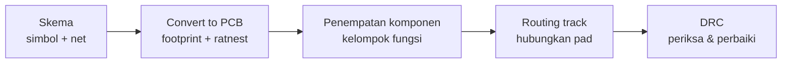

# Bahan Ajar Pertemuan 3: Desain Skematik dan PCB dengan EasyEDA

**Alokasi waktu:** 2 JP = 90 menit (asumsi 1 JP = 45 menit)  
**Sasaran:** SMA pemula; dapat disesuaikan untuk jenjang lain  
**Konteks proyek:** sistem penyiraman otomatis berbasis ESP32

## Gambaran pembelajaran

Siswa membuat skema (schematic) rangkaian sistem penyiraman — sensor kelembapan, ESP32, dan relay/driver — menggunakan EasyEDA, lalu mengubah skema tersebut menjadi tata letak (layout) PCB. Pertemuan ini berfokus pada simbol komponen, koneksi (net), konversi skema ke PCB, penempatan komponen, dan routing dasar. Fabrikasi/pemesanan PCB dan penyolderan dilakukan terpisah dengan pengawasan guru.

### Mengapa memakai EasyEDA?

EasyEDA dipilih karena dapat diakses gratis melalui peramban (browser), terintegrasi dengan pustaka komponen, dan cukup sederhana untuk pemula. Alur di EasyEDA mengikuti urutan yang logis: gambar skema dulu, lalu ubah menjadi PCB, kemudian periksa dengan DRC. Urutan ini juga melatih cara berpikir "rancang dulu, baru rakit".

### Tujuan pembelajaran

Pada akhir pembelajaran, siswa mampu:

1. Menjelaskan perbedaan skema (hubungan listrik) dan layout PCB (bentuk fisik papan).
2. Mengenali simbol komponen dasar: resistor, kapasitor, dioda, transistor, dan header/konektor.
3. Membuat atau mereproduksi skema sederhana di EasyEDA dengan net label, GND, dan VCC yang benar.
4. Mengubah skema menjadi PCB dan menempatkan komponen secara berkelompok sesuai fungsi.
5. Melakukan routing jalur (track) dasar dan menjalankan DRC.
6. Menyebutkan pemeriksaan yang harus dilakukan sebelum desain PCB dianggap selesai.

### Kriteria keberhasilan

- Semua sambungan pada skema sesuai diagram acuan guru; label net (GND/VCC/sinyal) tidak tertukar.
- Setiap pin komponen terhubung (tidak ada ratnest yang tersisa tanpa alasan).
- Komponen pada PCB tidak saling bertumpuk dan DRC bersih dari error yang belum diperbaiki.
- Siswa dapat menjelaskan perbedaan skema dan layout PCB, serta fungsi net label.

### Prasyarat dan kosakata

Pengetahuan sebelumnya: siswa telah mengenali komponen dan sambungan sistem (Pertemuan 2). Istilah penting: **skema/schematic**, **simbol**, **komponen**, **net**, **net label**, **GND**, **VCC**, **footprint**, **layout PCB**, **track/jalur**, **via**, **ratnest**, dan **DRC**.

### Alat dan bahan

- Komputer dengan koneksi internet dan akun EasyEDA.
- Skema acuan yang disiapkan guru (sensor → ESP32 → relay/driver).
- Daftar komponen beserta nilai dan footprint yang sudah diperiksa guru.
- Lembar spesifikasi/datasheet komponen (sebagai rujukan footprint dan polaritas).
- Lembar kerja daftar komponen dan checklist.

**Persiapan guru:** buat dan uji skema acuan di EasyEDA, siapkan daftar komponen + footprint, dan contoh layout yang sudah lolos DRC. Verifikasi polaritas komponen (dioda, transistor) pada skema acuan. Batas kegiatan: ini desain digital; siswa belum memesan PCB, mencetak, atau menyolder. Ingatkan bahwa file produksi (Gerber) dan perakitan dilakukan pada tahap lain dengan pengawasan guru.

## Materi inti

### 1. Apa itu skema (schematic)?

Skema adalah gambar **hubungan listrik** antarkomponen menggunakan **simbol**, bukan bentuk fisik. Skema menjawab pertanyaan "apa terhubung ke apa", bukan "di mana letak komponen di papan".

- Simbol komponen bisa berbeda bentuk dari komponen aslinya.
- Posisi komponen dalam skema tidak sama dengan posisi di papan PCB.
- Skema dibaca lewat **net** (jaringan sambungan), bukan lewat letak.

### 2. Simbol komponen dasar

| Komponen | Simbol | Kegunaan dalam proyek |
|---|---|---|
| Resistor | Zigzag/kotak | Membatasi arus ke basis transistor |
| Kapasitor | Dua garis sejajar | Meratakan tegangan (opsional) |
| Dioda | Segitiga + garis | Flyback untuk melindungi dari lonjakan motor/relay |
| Transistor NPN | Tanda panah keluar | Saklar elektronik penggerak relay |
| Header/konektor | Kotak dengan pin | Titik hubung sensor, ESP32, dan beban |

Siswa tidak perlu menghafal semua sekaligus; pada pertemuan ini mereka mencocokkan simbol pada skema acuan dengan komponen nyata.

### 3. Net, net label, dan simbol daya

- **Wire** menghubungkan dua pin secara langsung.
- **Net label** memberi nama pada sambungan. Dua pin dengan net label yang sama dianggap terhubung walau tidak digambar dengan kawat panjang.
- **GND** dan **VCC** adalah simbol daya yang sekaligus merupakan net label.
- Contoh: pin OUT sensor diberi label `OUT_SENSOR`, lalu label yang sama dipakai di pin GPIO ESP32 — keduanya dianggap tersambung.

Memakai net label membuat skema lebih rapi dan mudah dibaca daripada banyak kawat bersilangan.

### 4. Skema acuan proyek

Skema acuan sistem penyiraman terdiri atas tiga kelompok: sensor, ESP32, dan relay/driver menuju pompa. Berikut gambaran sambungannya (bukan gambar jadi di EasyEDA):

```text
SENSOR (J1)                       ESP32 (J2)
  VCC  ─────────────────────────── 3V3
  GND  ─────────────────────────── GND
  OUT  ─────────────────────────── GPIO34 (analog)

ESP32 GPIO27 ── R1 (1 kΩ) ── Basis Q1 (NPN BC547)
VCC_5V ── kumparan Relay K1 ── Kolektor Q1
  D1 (1N4007) antiparalel dengan kumparan K1
  (katoda D1 ke VCC_5V, anoda D1 ke kolektor Q1)
Emitor Q1 ── GND

Kontak relay: COM ── VCC pompa; NO ── Pompa (+); Pompa (−) ── GND
```

Sisi kendali (GPIO → resistor → basis transistor) dan sisi beban (relay → pompa) tetap dipisah, sama seperti prinsip pada Pertemuan 2.

### 5. Dari skema ke PCB

Setelah skema selesai, EasyEDA dapat **mengubah skema menjadi PCB** (Convert to PCB):

- Setiap simbol komponen dipetakan ke **footprint**, yaitu gambar bentuk fisik kaki komponen di papan.
- Sambungan pada skema muncul sebagai **ratnest**: garis tipis yang menunjukkan kaki mana yang harus disambung, tetapi belum di-routing.
- Ratnest hanyalah petunjuk; jalur tembaga yang sebenarnya dibuat lewat routing.

### 6. Penempatan komponen dan routing

- **Penempatan:** kelompokkan komponen menurut fungsi (misalnya sensor dekat konektor, driver dekat relay), bukan menurut urutan skema. Perhatikan arah komponen berpolaritas (dioda, transistor, kapasitor elektrolit).
- **Routing:** tarik **track** (jalur tembaga) untuk menghubungkan pad sesuai ratnest. Gunakan **via** bila perlu berpindah lapisan (untuk papan dua sisi).
- Jalur daya (VCC, GND) biasanya dibuat lebih lebar daripada jalur sinyal; ikuti contoh guru.

### 7. Pemeriksaan dengan DRC

**DRC (Design Rule Check)** memeriksa aturan desain secara otomatis, misalnya jalur terlalu berdekatan, tidak terhubung, atau tumpang-tindih.

- Jalankan DRC setelah routing.
- Perbaiki setiap error/warning yang muncul.
- Periksa juga **ratnest**: pastikan tidak ada sambungan yang belum di-routing.

### 8. Batas dan keselamatan

- Pertemuan ini hanya **desain digital** di komputer; tidak ada tegangan berbahaya di meja kerja.
- Fabrikasi (pesan/cetak PCB), ekspor file Gerber, dan penyolderan komponen dilakukan pada tahap lain **dengan pengawasan guru**.
- Tetap jaga kerapian data: simpan proyek, beri nama file yang jelas, dan jangan mengubah pustaka komponen sembarangan.

## Alur pembelajaran (90 menit)

| Waktu | Tahap | Aktivitas guru | Aktivitas siswa / bukti |
|---:|---|---|---|
| 0–8 mnt | Pembuka dan apersepsi | Tunjukkan papan PCB nyata dan tanyakan: “Bagaimana rangkaian kabel yang berantakan bisa menjadi papan yang rapi?” Kenalkan EasyEDA dan tujuannya. | Menjawab; menyebutkan apa yang pernah dilihat pada papan elektronik. |
| 8–20 mnt | Skema dan simbol | Jelaskan perbedaan skema vs bentuk fisik. Kenalkan simbol resistor, kapasitor, dioda, transistor, header. | Mencocokkan simbol dengan komponen nyata pada lembar kerja. |
| 20–35 mnt | Net dan koneksi | Jelaskan wire, net label, GND, dan VCC. Demonstrasikan: tempatkan simbol, hubungkan, beri label di EasyEDA. | Menyalin skema kecil (sensor → ESP32) dengan net label. |
| 35–50 mnt | Skema acuan proyek | Pandu siswa menggambar skema lengkap sensor → ESP32 → relay/driver (resistor, transistor, dioda, relay). | Menggambar skema lengkap di EasyEDA; menyimpan proyek. |
| 50–65 mnt | Skema ke PCB dan penempatan | Demonstrasikan Convert to PCB; jelaskan footprint dan ratnest. Minta siswa menempatkan komponen berkelompok. | Menempatkan komponen pada area PCB sesuai fungsi. |
| 65–78 mnt | Routing dan DRC | Pandu routing track dan penggunaan via. Minta siswa menjalankan DRC dan memperbaiki error. | Melakukan routing; menjalankan DRC; memperbaiki error/warning. |
| 78–90 mnt | Penutup / exit ticket | Tinjau beberapa hasil. Berikan tiga pertanyaan singkat. Tegaskan fabrikasi dan solder dilakukan terpisah dengan pengawasan. | Menjawab exit ticket; menyimpan proyek dan mengisi checklist. |

## Lembar kerja siswa

**Nama:** ____________________  **Kelompok:** __________  **Tanggal:** __________

### A. Daftar komponen

Isi berdasarkan skema acuan yang diberikan guru.

| Nama komponen | Simbol yang dipakai | Nilai/spesifikasi | Footprint (dari daftar guru) |
|---|---|---|---|
| Resistor R1 | | | |
| Dioda D1 | | | |
| Transistor Q1 | | | |
| Relay K1 | | | |
| Header sensor J1 | | | |
| Header/konektor ESP32 | | | |

### B. Daftar net

Tuliskan net label yang kamu pakai dan pin/komponen yang terhubung.

| Net label | Pin/komponen yang terhubung |
|---|---|
| GND | |
| VCC / 3V3 / 5V (sesuai skema) | |
| Sinyal sensor (mis. OUT_SENSOR) | |
| Sinyal kendali (mis. GPIO27) | |

### C. Checklist skema

Beri tanda ✔ pada setiap pernyataan yang sudah benar.

- [ ] Semua pin sensor (VCC, GND, OUT) terhubung ke tempat yang benar.
- [ ] Net label GND dan VCC tidak tertukar.
- [ ] Sinyal sensor menuju pin analog ESP32 yang benar.
- [ ] Dioda D1 terpasang dengan arah (polaritas) yang benar.
- [ ] Transistor Q1 (basis, kolektor, emitor) terhubung sesuai skema acuan.

### D. Checklist layout dan DRC

- [ ] Semua komponen ditempatkan dan tidak saling bertumpuk.
- [ ] Komponen berpolaritas menghadap arah yang benar.
- [ ] Ratnest kosong (semua sambungan sudah di-routing).
- [ ] DRC dijalankan dan error sudah diperbaiki.

### E. Jelaskan dengan kata-katamu

1. Apa perbedaan skema dan layout PCB?
2. Apa fungsi net label, dan mengapa dipakai?
3. Apa itu ratnest pada tahap PCB?
4. Mengapa dioda D1 perlu dipasang pada kumparan relay?
5. Apa yang kamu periksa sebelum desain PCB dianggap selesai?

## Contoh diagram konseptual

Diagram ini menunjukkan alur pengerjaan di EasyEDA, bukan hasil akhir yang benar untuk semua board. Guru harus memastikan skema acuan, komponen, dan footprint sesuai dengan modul yang benar-benar dipakai.



Skema acuan proyek (ringkas):

```text
Sensor J1 (VCC,GND,OUT) ──> ESP32 (3V3, GND, GPIO34 analog)
ESP32 GPIO27 ── R1 ── Basis Q1 (NPN)
VCC_5V ── kumparan Relay K1 ── Kolektor Q1
D1 (1N4007) antiparalel kumparan K1 (katoda ke VCC_5V)
Emitor Q1 ── GND
Relay: COM ── VCC pompa; NO ── Pompa (+); Pompa (−) ── GND
```

Pastikan polaritas dioda dan transistor mengikuti skema acuan guru; kesalahan arah dapat membuat rangkaian tidak bekerja atau rusak saat dirakit nanti.

## Asesmen

### Asesmen formatif

Guru mengamati saat siswa:

- mencocokkan simbol dengan komponen nyata;
- memberi net label GND/VCC/sinyal tanpa tertukar;
- menempatkan komponen berkelompok dan memperhatikan polaritas;
- menjalankan DRC dan memperbaiki error;
- menjelaskan perbedaan skema dan layout PCB.

### Exit ticket

1. Apa perbedaan skema (schematic) dan layout PCB?
2. Apa fungsi net label pada skema?
3. Apa yang diperiksa oleh DRC?
4. Mengapa fabrikasi dan penyolderan PCB dilakukan dengan pengawasan guru, bukan mandiri?

### Rubrik bukti belajar (10 poin)

| Aspek | 2 poin | 1 poin | 0 poin |
|---|---|---|---|
| Skema | Semua sambungan dan net label benar sesuai acuan | Ada kekeliruan kecil yang diperbaiki setelah ditinjau | Skema belum lengkap/salah besar |
| Simbol & polaritas | Simbol dan arah dioda/transistor benar | Sebagian benar, perlu diingatkan | Polaritas terbalik/tidak dikenali |
| Layout & penempatan | Komponen rapi, tidak bertumpuk, berkelompok fungsi | Rapi setelah diarahkan | Berantakan/tumpang-tindih |
| Routing & DRC | Ratnest kosong dan DRC bersih | Masih ada error kecil yang diperbaiki | Belum routing/DRC tidak dijalankan |
| Komunikasi | Dapat menjelaskan skema vs layout dan fungsi net label | Penjelasan sebagian | Tidak dapat menjelaskan |

**Tuntas:** minimal 7/10 dan tidak ada kesalahan polaritas kritis (misalnya dioda terbalik) pada desain. Guru dapat meminta siswa memperbaiki sebelum dinilai tuntas.

## Kunci jawaban / panduan guru

- Bagian A/B: jawaban mengikuti skema acuan dan daftar komponen yang benar-benar tersedia.
- Bagian C/D: checklist mengikuti skema acuan; poin utama adalah net label tidak tertukar, polaritas dioda/transistor benar, ratnest kosong, dan DRC bersih.
- Pertanyaan 1: skema menggambarkan hubungan listrik antarkomponen (apa terhubung ke apa), sedangkan layout PCB menggambarkan letak fisik komponen dan jalur tembaga di papan.
- Pertanyaan 2: net label memberi nama sambungan sehingga pin dengan label sama dianggap terhubung tanpa kawat panjang; membuat skema rapi.
- Pertanyaan 3: ratnest adalah garis tipis penunjuk kaki yang perlu disambung, sebelum jalur sebenarnya dibuat lewat routing.
- Pertanyaan 4: dioda flyback membatasi lonjakan tegangan saat kumparan relay/motor dimatikan, melindungi transistor/driver.
- Pertanyaan 5: pastikan sambungan sesuai skema acuan, polaritas benar, ratnest kosong, dan DRC bersih.
- Exit ticket: (1) skema = hubungan listrik; layout = bentuk fisik papan. (2) memberi nama sambungan agar pin dengan label sama dianggap terhubung. (3) memeriksa aturan desain seperti jalur terlalu dekat, tidak terhubung, atau tumpang-tindih. (4) karena melibatkan proses fabrikasi dan tegangan/solder yang memerlukan pemeriksaan dan pengawasan guru.

## Keselamatan wajib

1. Gunakan skema acuan dan daftar komponen yang sudah diperiksa guru; jangan mengubah nilai komponen sembarangan.
2. Perhatikan polaritas dioda dan transistor; arah terbalik dapat merusak komponen saat dirakit.
3. Simpan proyek secara teratur dan beri nama file yang jelas agar mudah ditinjau guru.
4. Fabrikasi, ekspor Gerber, dan penyolderan hanya dilakukan dengan pengawasan guru dan mengikuti prosedur.
5. Desain digital ini aman dari tegangan, tetapi tetap jaga kerapian area kerja dan perangkat komputer.

## Diferensiasi dan tindak lanjut

- **Dukungan:** sediakan skema acuan setengah jadi (tinggal dihubungkan), daftar net label yang sudah disiapkan, dan contoh layout separuh jadi. Pasangkan siswa yang membutuhkan bantuan dengan teman pendamping.
- **Pengayaan:** minta siswa menambah kapasitor filter pada catu, atau membandingkan dua tata letak (lebar jalur daya vs sinyal) berdasarkan contoh guru, tanpa mengubah skema acuan utama.
- **Batas materi:** kegiatan Pertemuan 3 berakhir setelah skema dan layout lolos DRC. Fabrikasi/pemesanan PCB dan penyolderan dilakukan pada tahap perakitan dengan pengawasan guru.
